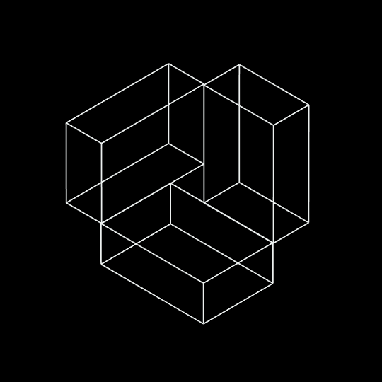

  

  
  
  
  
  

 

  

<table align="center">
  <tr>
    <td width="58%" valign="top">
      <h3>Engineering Profile</h3>
      
<strong>Prague, Czechia</strong>

      
I build web products and the systems that ship them. My work spans travel booking, fintech, and B2B SaaS, from React and Svelte interfaces to Node.js APIs, shared packages, and production infrastructure.

      
I’ve also built native Android software and taught web engineering in Prague and Kyiv.

      

        
      

    </td>
    <td width="42%" valign="top" align="center">
      
    </td>
  </tr>
</table>

 

<h2 align="center">Current Work</h2>

<table align="center">
<tr>
<td width="50%" valign="top">

<strong>Full-Stack &amp; DevOps Engineer · Aug 2026 – present</strong>

I work across ASIANA’s travel booking, content management, airline distribution, and developer tooling.

<ul>
<li><strong>Letuška CMS.</strong> Built a visual block editor with responsive previews, undo and redo, reusable sections, and data-driven content. Implemented multilingual preview and publishing workflows, and contributed catalog blocks, content models, and search filters for the Study.cz migration.</li>
<li><strong>Travel booking.</strong> Modernized <a href="https://letim.cz/">letim.cz</a> across SvelteKit and Express. Migrated the monorepo to pnpm, upgraded dependencies, expanded GitLab CI test coverage, and strengthened types across hotel booking, checkout, and shared models. Worked on Docker and Kubernetes deployment configuration.</li>
<li><strong>Airline distribution.</strong> Built an Angular admin interface, REST API, and PostgreSQL layer for managing routes and departure airports, with bulk edits, import and export, and automated validation.</li>
<li><strong>Developer tooling.</strong> Built a shared configuration package and CLI for Angular, SvelteKit, and Express. Rolled out checks for accessibility, localization, testing, and code quality across the mobile app, flight map, and partner portal, and extracted reusable localization tooling from the SvelteKit starter.</li>
</ul>
</td>
<td width="50%" valign="top">

<strong>Browser-based accounting SaaS</strong>

I built the initial product for <a href="https://www.lvaccounting.eu/">LV účetnictví</a> in Jul–Aug 2026 and continue to develop it. It converts bank statements into <strong>POHODA XML, MultiCash, and ABO/GPC</strong>. The product now also supports invoice imports for POHODA. Source documents are processed in the browser.

<ul>
<li>Built bank-specific parsers, opening and closing balance reconciliation, and a Vitest matrix covering <strong>165 bank, currency, and export combinations</strong> at launch.</li>
<li>Added conversion previews, saved export profiles, and batch ZIP downloads. Built with Next.js, TypeScript, Redux Toolkit, and Tailwind CSS, with Clerk for authentication, Stripe for billing, and Cloudflare Pages and D1 for hosting and data.</li>
</ul>
</td>
</tr>
</table>

<h2 align="center">Engineering Experience</h2>

<table align="center">
<tr>
<td width="50%" valign="top">

        
         
        
      

<strong>Time Anthropology Foundation · Frontend Team Lead · Started Mar 2026</strong>

Led a three-person frontend team and shipped customer and back-office apps on a React 19 monorepo with a shared Mantine component library.

Project details

<ul>
<li>Led a three-person frontend team while implementing features, reviewing code, and making architecture decisions.</li>
<li>Built a React 19 and TypeScript monorepo with Vite, pnpm, and Turborepo. Published a shared Mantine-based UI library to a private GitLab npm registry.</li>
<li>Shipped a mobile-first customer app and a back-office admin app from the same UI foundation, with Redux Toolkit, localization, analytics, and a shared release pipeline.</li>
</ul>

<a href="https://www.tafprojects.com/">TAF Projects</a>

</td>
<td width="50%" valign="top">

        
         
        
      

<strong>Frontend Platform, DevOps &amp; Android · Nov 2024 – May 2026</strong>

Rebuilt a live crypto exchange into independently deployable React apps, owned multi-host release infrastructure, and built a Kotlin app for hardware-backed transaction signing.

Project details

<ul>
<li><strong>Frontend Platform Engineer · Nov 2024 – May 2026.</strong> Rebuilt the frontend of a live crypto exchange from React 17 and Parcel into a React 19, Vite, and pnpm/Turborepo monorepo. Split exchange, wallet, landing, and maintenance into independently deployable apps and built shared UI and app foundations. Owned frontend API contracts, state, localization, tests, and release tooling.</li>
<li><strong>Platform &amp; Release / DevOps Engineer · Jun 2025 – May 2026.</strong> Owned multi-host Docker and Traefik delivery for the exchange, wallet, landing, and WordPress sites. Set up per-app GitLab pipelines, private npm publishing, environment promotion, and production observability. Ran wallet infrastructure and managed secure operator access.</li>
<li><strong>Android Application Engineer · Sep 2025 – Jan 2026.</strong> Built a Kotlin and Jetpack Compose app for hardware-backed transaction signing using Android Keystore and ECDSA. Used Room, DataStore, OkHttp, and WorkManager. Automated signed APK releases in GitLab CI, added in-app updates, and reduced APK size by 64% with R8.</li>
</ul>

<a href="https://www.simplecoin.eu/en">Simplecoin</a> · <a href="https://exchange.simplecoin.eu/">Exchange</a> · <a href="https://wallet.simplecoin.eu/">Wallet</a>

</td>
</tr>
<tr>
<td width="50%" valign="top">

        
         
        
      

<strong>Infrastructure Team Lead / Acting CTO · Jun–Dec 2025</strong>

Led infrastructure and security for a fintech payments platform, covering Linux operations, identity, disaster recovery, monitoring, and an Angular operator console.

Project details

<ul>
<li>Owned Linux, PostgreSQL, Nginx, and systemd infrastructure for a fintech payments platform. Defined backup and disaster recovery runbooks, vulnerability management, and production operations.</li>
<li>Set up identity and access with Keycloak and Camunda, integrated DFNS, and implemented security monitoring with Wazuh and SIEM tooling.</li>
<li>Delivered and maintained the Angular operator console and its deployment pipeline.</li>
</ul>

<a href="https://odinpay.eu/">Odin Pay</a>

</td>
<td width="50%" valign="top">

        
         
        
      

<strong>Engineering Educator &amp; Course Author</strong>

Mentored 18+ frontend cohorts in Prague and created and taught a practical Node.js course in Kyiv.

Project details

<ul>
<li><strong>Prague · Frontend Engineering Educator &amp; Mentor · Jan 2023 – Oct 2025.</strong> Mentored 18+ cohorts through project-based HTML, CSS, JavaScript, React, architecture, and debugging. <a href="https://praha.itstep.org/">STEP IT Academy Praha</a></li>
<li><strong>Kyiv · Backend Engineering Educator &amp; Course Author · Jan–Jul 2024.</strong> Designed and taught a practical Node.js course covering Express, PostgreSQL, MongoDB, authentication, WebSockets, email workflows, and cloud deployment. <a href="https://itstep.org/ru">STEP IT Academy</a></li>
</ul>

</td>
</tr>
<tr>
<td width="50%" valign="top">

<strong>INSTARUM · Freelance Frontend Engineer · May–Jun 2026</strong>

Delivered a four-language Next.js 16 and React 19 site for a Prague engineering company, with an accessible project gallery, light and dark themes, a validated contact form, Resend, structured SEO, and Google Consent Mode. <a href="https://www.instarum.cz/">INSTARUM</a>

</td>
<td width="50%" valign="top">

        
         
        
      

<strong>LV účetnictví · Frontend Engineer · Aug 2025</strong>

Built a multilingual Next.js marketing site with pricing tied to package-specific enquiries, Resend confirmations, Google Sheets review ingestion, GTM lead events, and GitHub Actions deployments to Vercel. <a href="https://www.lvaccounting.eu/">LV účetnictví</a>

</td>
</tr>
<tr>
<td width="50%" valign="top">

<strong>Create Business Club · Webflow Developer / Layout Designer · Nov 2024 – Jan 2025</strong>

Built responsive marketing pages and maintained their content in Webflow.

</td>
<td width="50%" valign="top">

        
         
        
      

<strong>ART VIKO · Full-Stack Web Developer · Oct 2022 – Mar 2023</strong>

Built a React, Express, and MongoDB workforce and payroll platform with role-based access, JWT, multilingual workflows, editable grouped tables, ASMIS integration, and internal reporting. <a href="https://www.artviko.cz/cs">ART VIKO</a>

</td>
</tr>
</table>

<h2 align="center">Technology Stack</h2>

  
   
  <h3>Frontend Foundation</h3>
  
  
  
  
   
  
  
   
  
  
  
  
  
  
  

 

<table align="center">
  <tr>
    <td align="center" valign="top" width="50%">
      <h3>Architecture &amp; UI</h3>
      
      
      
      
      
      
      
      
      
      
      
      
      
      
      
    </td>
    <td align="center" valign="top" width="50%">
      <h3>Backend &amp; APIs</h3>
      
      
      
      
      
      
      
      
      
      
      
      
      
      
      
      
      
      
    </td>
  </tr>
  <tr>
    <td align="center" valign="top" width="50%">
      <h3>Platform &amp; Delivery</h3>
      
      
      
      
      
      
      
      
      
      
      
      
      
      
      
      
      
      
      
      
    </td>
    <td align="center" valign="top" width="50%">
      <h3>Quality &amp; Observability</h3>
      
      
      
      
      
      
      
      
      
      
      
      
      
      
      
      
    </td>
  </tr>
</table>

<h2 align="center">Current Focus</h2>

<table align="center">
  <tr>
    <td valign="top" width="33%">
      <h3>Frontend Architecture</h3>
      

        
      

      

        SvelteKit and React applications, shared UI foundations, routing,
        localization, and typed monorepos with per-package test coverage.
      

    </td>
    <td valign="top" width="33%">
      <h3>Platform Engineering</h3>
      

        
      

      

        Docker and Kubernetes, GitLab CI/CD, private registries, Nginx and
        Traefik routing, and OpenTelemetry for production releases.
      

    </td>
    <td valign="top" width="33%">
      <h3>Secure Product Delivery</h3>
      

        
      

      

        Booking and payment integrations, session-based authentication,
        hardware-backed signing, and browser-based document processing.
      

    </td>
  </tr>
</table>

<h2 align="center">Education &amp; Certifications</h2>

        
      

<ul>
<li><strong>MSc, Automation and Computer-Integrated Technologies</strong> · Donbas State Engineering Academy · 2022–2023</li>
<li><strong>BSc, Automation and Computer-Integrated Technologies</strong> · Donbas State Engineering Academy · 2018–2022</li>
<li><strong>Full-Stack Developer</strong> · <a href="https://goit.global/ua/">GoIT</a> · 2022</li>
<li><strong>Front-End Developer</strong> · <a href="https://itstep.org/ru">Computer Academy STEP</a> · 2021</li>
</ul>

<a href="https://www.dgma.donetsk.ua/">Donbas State Engineering Academy</a>

<h2 align="center">Build Principles</h2>

  
   
  
  
  
  
  

 

  

